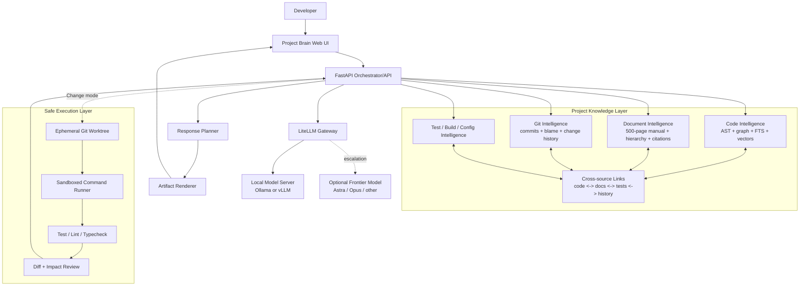
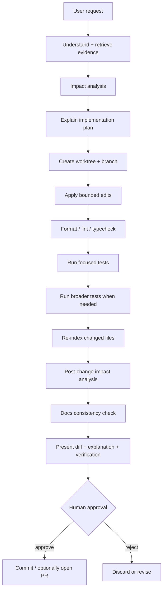
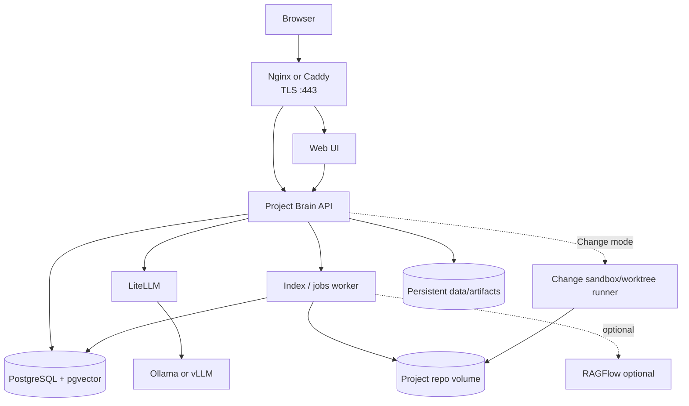

# Project Brain — Master Architecture & Implementation Plan

> **Purpose:** Build a private, project-specific AI engineering expert hosted on the user's OVH server. It must deeply understand one specific software repository plus approximately 500 pages of project documentation, answer onboarding and technical questions clearly, produce rich artifacts and diagrams, trace its answers to evidence, and eventually make safe code changes in isolated workspaces. Local inference is the default. A frontier model such as GPT-6 Astra, Claude Opus, or another provider may optionally act as a high-level orchestrator through a user-supplied API key.
>
> **Audience:** Codex / implementation agent. Treat this document as a product + architecture specification, not as loose brainstorming.
>
> **Research snapshot:** 2026-10-03. Repository metadata and implementation details can change; re-check upstream before vendoring or integrating code.

---

## 0. Executive summary

We are **not** building another generic “chat with a GitHub repo” app.

We are building a **single-project engineering brain** with three equally important identities:

1. **Project Expert** — knows the repository, documentation, tests, configuration, database structures, Git history, and business terminology.
2. **Engineering Agent** — can investigate bugs, trace behavior, analyze impact, run tests, and later propose or apply safe changes inside isolated worktrees/sandboxes.
3. **Project Teacher** — explains the system so well that a new developer can actually learn it, using plain language, code blocks, notes, warnings, diagrams, architecture maps, sequence diagrams, database views, diffs, source cards, interactive walkthroughs, and “what to read next.”

The system should feel like a senior engineer who has worked on the project for years **and is unusually good at onboarding people**.

### Core technical principle

Do **not** try to “memorize the repository” primarily through model fine-tuning.

Project facts should live in an up-to-date knowledge system:

- AST-derived code graph
- exact lexical index
- semantic/vector index
- documentation hierarchy
- documentation-to-code links
- Git history and blame data
- tests and build/config artifacts
- generated architecture/process metadata

The LLM should retrieve and reason over the right evidence. Fine-tuning, if used later, should teach **behavior, explanation style, tool usage, and project conventions**, not serve as the authoritative store of changing source-code facts.

### Preferred implementation strategy

Do **not** literally merge every upstream repository into one codebase. That would create licensing, maintenance, security, and architecture problems.

Instead:

- **Base platform:** start from or heavily reuse **PorunC/CodeWiki** (MIT) because it already has FastAPI + React, AST graphs, GraphRAG, source-grounded wiki generation, citations, diagrams, LiteLLM routing, MCP, SQLite/PostgreSQL support, incremental indexing, and a clear modular design.
- **Documentation-generation algorithms:** port/adapt selected ideas and MIT-licensed implementation from **FSoft-AI4Code/CodeWiki**, especially hierarchical decomposition, artifact-aware generation, component-level incremental updates, dependency-ordered documentation, and benchmark methodology.
- **Code intelligence ideas:** study **GitNexus** deeply, especially precomputed relational intelligence, impact analysis, process tracing, route maps, change detection, and graph-first tools. **Do not copy its implementation into a commercial product without permission**, because the current repository uses the PolyForm Noncommercial license.
- **Rich explanation UX:** reproduce the concepts of **alexanderop/walkthrough** — clickable Mermaid diagrams, code snippets, source paths, pan/zoom, detail panels — but treat its code as **reference-only** because no LICENSE file was visible during research.
- **Document intelligence:** integrate **RAGFlow** as an optional sidecar or borrow its Apache-2.0 concepts for layout-aware document parsing, citations, knowledge compilation, and agentic retrieval. Do not require the full RAGFlow stack if the OVH machine is too small.
- **Artifacts UI:** copy the interaction *pattern* from **Open WebUI** (artifact panel, versioning, sandboxed previews, CSP), but do not make it the base product because its current license contains branding restrictions.
- **Safe code execution:** study or optionally integrate **OpenHands** Agent Server / sandbox patterns rather than giving the chat process unrestricted shell access.
- **Provider/model routing:** use **LiteLLM** directly as the gateway.
- **Local inference:** Ollama for simple/local development; vLLM for production GPU serving when hardware supports it.
- **Parsing:** Tree-sitter directly.
- **Storage:** PostgreSQL + full-text search + pgvector first. Add Qdrant only if benchmarks show a real need. Avoid unnecessary datastore sprawl.

---

# 1. Product definition

## 1.1 Main user promise

A developer should be able to open the application and ask:

- “Explain the complete authentication flow.”
- “Where is invoice generation implemented?”
- “Why does retrying a payment sometimes create two records?”
- “Which services depend on `CustomerService`?”
- “What happens after this frontend button is clicked?”
- “What does the documentation mean by customer validation, and where is that in the code?”
- “What changed in this subsystem over the last six months?”
- “What would break if I changed this function signature?”
- “Teach me this repository from zero.”
- “Show the database relationships for onboarding.”
- “Add a new payment provider, but show me your plan and impact first.”

The system should answer with the **best explanatory medium**, not simply a block of prose.

## 1.2 Project-only identity

The assistant's system identity should be conceptually:

```text
You are the engineering assistant for Project X.

Authoritative project sources:
1. Current Project X source repository
2. Project X tests
3. Project X official documentation
4. Project X Git history
5. Project X configuration/build/deployment artifacts

Never invent project behavior.
For current implementation behavior, prioritize current source + tests.
For intended/business behavior, prioritize official documentation.
When implementation and documentation disagree, report the conflict explicitly.
Cite exact project evidence whenever possible.
If something cannot be verified, say so.
General software-engineering knowledge may be used to teach concepts, but must not be presented as a fact about Project X unless project evidence supports it.
```

## 1.3 Non-goals for the first version

Do not turn Phase 1 into:

- a general web-search assistant
- a generic autonomous coding platform
- an IDE replacement
- a multi-repository enterprise knowledge graph
- a fully fine-tuned proprietary foundation model
- a dozen-agent simulation where every trivial query invokes multiple LLMs
- a public shell exposed through a chatbot

The system should be excellent at **one project first**.

---

# 2. Critical design principles

## 2.1 Facts outside the model, reasoning inside the model

The model should not be trusted to store exact project facts through weights. Keep current facts externally retrievable.

```text
Project repository
      +
500-page documentation
      +
Git history
      +
Tests/config/build artifacts
      ↓
Deterministic parsing + indexing
      ↓
Project Knowledge Layer
      ↓
Relevant evidence pack
      ↓
LLM reasoning / explanation
```

## 2.2 Deterministic tools before additional agents

Avoid this as the default:

```text
Manager AI -> Search AI -> Code AI -> Docs AI -> Review AI -> answer
```

Prefer:

```text
Orchestrator
   ├─ find_symbol()
   ├─ find_callers()
   ├─ trace_execution()
   ├─ impact_analysis()
   ├─ search_docs()
   ├─ read_doc_section()
   ├─ git_history_for_symbol()
   └─ run_tests()
```

These tools should return structured, precomputed evidence. Multi-agent work is an **escalation path**, not the routine path.

## 2.3 Explanation is a first-class subsystem

Correctness without understanding is not enough.

Every substantial answer should be able to combine:

- short direct answer
- big-picture explanation
- step-by-step flow
- “why it is designed this way”
- code excerpts
- exact source references
- notes/tips/warnings
- architecture diagrams
- sequence diagrams
- ER/data-model diagrams
- dependency/call graphs
- diffs
- test results
- documentation excerpts
- “what to read next”

But the response depth must be adaptive: a “where is X?” question should stay concise.

## 2.4 Source-grounded diagrams wherever possible

When a diagram can be generated from graph facts, **do not ask an LLM to invent the topology**.

Use deterministic graph facts to generate nodes/edges, and let the model only:

- select which parts matter
- label them for human comprehension
- explain them

This reduces visually convincing hallucinations.

## 2.5 Project code and documentation must be linked, not siloed

Do not create two disconnected systems named “code RAG” and “PDF RAG.”

The knowledge graph should be able to represent:

```text
Manual §12.4 "Payment retry"
        │
        ├─ DOCUMENTS -> PaymentRetryService
        ├─ DOCUMENTS -> retryPayment()
        ├─ REFERENCES -> PAYMENT_RETRY_LIMIT
        └─ CONTRADICTS? -> implementation behavior
```

This is a key differentiator.

## 2.6 Current implementation vs intended behavior

The system must distinguish:

- **implemented behavior** — current code/tests
- **documented/intended behavior** — official documentation
- **historical behavior** — Git history
- **model inference** — reasoned but not directly proven

Never silently collapse them.

---

# 3. Upstream repository research and reuse strategy

The repositories below were investigated on GitHub on 2026-10-03. Star counts are only rough maturity signals and will change.

## 3.1 FSoft-AI4Code/CodeWiki

**Repository:** https://github.com/FSoft-AI4Code/CodeWiki  
**Snapshot:** ~1.7k stars, active, Python, MIT, Findings of ACL 2026.  
**Role for us:** major source for repository-level documentation algorithms.

### What it does well

- Builds a dependency graph from a repository.
- Hierarchically decomposes large repositories into modules.
- Uses recursive agents: leaf modules first, parent pages from child pages.
- Supports multiple languages and very large repositories.
- Generates Mermaid diagrams and validates them.
- Treats build/config/deployment artifacts as first-class graph nodes.
- Performs **component-level incremental updates**, not simplistic file-level rebuilds.
- Can patch only affected documentation pages after changes.
- Has an MCP server and supports external agents/IDEs.
- Includes explicit benchmarking via CodeWikiBench.

### Important ideas to reuse

#### A. Artifact-aware indexing

Treat these as project knowledge, not noise:

- manifests: `package.json`, `pyproject.toml`, `Cargo.toml`, etc.
- builds: Make/CMake/Gradle/etc.
- containers: Dockerfiles / compose
- CI workflows
- packaging/deployment files
- testing infrastructure
- schemas/OpenAPI/proto
- config
- scripts

This is important because new developers ask “How is this deployed?”, “Where is this env var consumed?”, “Which CI job runs this?”, not only function-level questions.

#### B. Component-level incremental updates

FSoft CodeWiki 2.0 distinguishes:

- unchanged
- body-changed
- signature-changed
- added
- deleted
- likely renamed components

It then updates affected leaf modules/pages and propagates only relevant changes. We should apply the same principle to **indexes, generated explanations, and doc-code links**.

#### C. Full-build fallback

If too much changes, incremental repair becomes unsafe/inefficient. Maintain thresholds and fall back to full reindex/regeneration when graph topology changes substantially.

### Recommended usage

**Safe to reuse/adapt with MIT attribution.** Do not blindly run a second parallel wiki architecture beside PorunC CodeWiki forever. Prefer porting the strongest algorithms into one unified backend.

---

## 3.2 PorunC/CodeWiki

**Repository:** https://github.com/PorunC/CodeWiki  
**Snapshot:** ~159 stars, Python, MIT.  
**Role for us:** strongest practical starting platform/base.

### Why it is especially close

It already contains:

- FastAPI backend
- React frontend
- repository scanner
- Tree-sitter/AST parsing
- deterministic code graph
- imports/calls/routes/inheritance/config usage
- graph communities
- GraphRAG retrieval
- full-text search
- optional vectors
- SQLite and PostgreSQL
- LiteLLM-powered Q&A
- source-grounded wiki generation
- server-generated Mermaid diagrams from graph facts
- source citation validation
- incremental update logic
- MCP
- Codex skill integration
- a “Lite Mode” specifically intended for AI agents that need source context, traces, callers, and affected-file analysis

### Architectural pieces to reuse heavily

PorunC's documented pipeline is conceptually:

```text
RepoScanResult
  -> parse_scanned_files
  -> GraphBuilder.build
  -> CommunityDetector.detect
  -> CommunityRecordBuilder.build_all
  -> persistent store
```

GraphRAG is roughly:

```text
query
 -> symbol seeds
 -> FTS seeds
 -> optional vector seeds
 -> graph expansion
 -> related edges
 -> budgeted source chunks
 -> community summaries
 -> structured context pack + trace id
```

This is almost exactly the retrieval foundation we need.

### Particularly good design decision to keep

Its wiki diagrams are generated from graph facts, not freeform hallucinated Mermaid. Keep that philosophy for all our visual artifacts.

### Recommended usage

**Preferred fork/base**, unless inspection of the user's real repository reveals a blocker. Preserve MIT attribution and upstream notices.

---

## 3.3 abhigyanpatwari/GitNexus

**Repository:** https://github.com/abhigyanpatwari/GitNexus  
**Snapshot:** ~47k stars, active, TypeScript.  
**License:** PolyForm Noncommercial 1.0.0 at research time.  
**Role for us:** architecture/reference source for deep code intelligence, not a default source-code dependency for commercial use.

### Why it matters

GitNexus's most useful concept is **precomputed relational intelligence**.

Instead of forcing an LLM to discover all dependencies through repeated searches, indexing computes structure in advance. Its tools include concepts such as:

- hybrid query
- 360-degree symbol context
- impact/blast radius
- trace between symbols
- Git-diff change detection
- route maps
- API impact
- shape checks
- file reads / grep
- process clusters / execution flows
- optional PDG/data-flow/taint queries

### Ideas to reproduce independently

- `context(symbol)` — one call returns categorized references and process participation.
- `impact(symbol, direction, depth)` — pre-change blast radius.
- `trace(A, B)` — shortest meaningful directed path.
- `detect_changes(diff)` — map changed lines/symbols to affected processes.
- `route_map()` — frontend/API/handler relationships.
- `api_impact(route)` — consumers and shape dependencies before changing an endpoint.
- precomputed process clusters and execution flows.

### Licensing rule

Do **not** copy or vendor GitNexus source into a product that may have commercial use without verifying the license or obtaining permission. Study its public architecture and independently implement equivalent ideas using MIT/Apache components.

---

## 3.4 alexanderop/walkthrough

**Repository:** https://github.com/alexanderop/walkthrough  
**Snapshot:** ~139 stars.  
**License observation:** no `LICENSE` file was visible via GitHub during research.  
**Role for us:** UX/interaction inspiration only unless licensing is clarified.

### Why it is highly relevant

It generates interactive HTML walkthroughs that contain:

- clickable Mermaid flowcharts / ER diagrams
- detail panel per node
- plain-English descriptions
- source paths
- syntax-highlighted code snippets
- pan / zoom
- dark mode
- a goal of giving newcomers a mental model in minutes

It also includes an evaluation harness with deterministic checks plus an LLM rubric grader.

### What we should reproduce in our own implementation

For any architecture/process answer, users should be able to click a node such as `PaymentService` and see:

```text
PaymentService

Purpose
Handles authorization, capture and retry decisions.

Defined
src/payments/payment.service.ts:20-240

Called by
CheckoutController
RetryWorker

Calls
PaymentGateway
PaymentRepository

Documentation
Manual §12.2, §12.4
```

Then show the most relevant code excerpt.

### Licensing rule

Until a license is confirmed, **do not copy implementation code or templates**. Reimplement the interaction pattern ourselves.

---

## 3.5 facebookresearch/DocAgent

**Repository:** https://github.com/facebookresearch/DocAgent  
**Snapshot:** ~453 stars, Python, MIT.  
**Role for us:** reference for hierarchical documentation and verifier patterns.

### Relevant concepts

DocAgent uses specialized roles:

- Reader
- Searcher
- Writer
- Verifier
- Orchestrator

and processes code hierarchically to improve contextual documentation.

### What to use

Use its **verification mindset** and hierarchical sequencing. Do not make every user query invoke five agents. Its multi-agent structure is more useful for offline generation/evaluation than for every real-time chat message.

---

## 3.6 infiniflow/ragflow

**Repository:** https://github.com/infiniflow/ragflow  
**Snapshot:** ~91k stars, Apache-2.0.  
**Role for us:** strongest reference/optional service for the 500-page documentation corpus.

### Relevant capabilities

- deep document understanding
- layout-aware ingestion
- complicated formats and tables
- configurable/template-based chunking
- grounded citations
- multiple recall + reranking
- agentic multi-step retrieval
- knowledge compilation into wiki/graphs/trees/page indexes/mind maps/timelines/skills
- local Docker deployment

RAGFlow's current README recommends roughly **4 CPU cores, 16 GB RAM and 50 GB disk** as a starting point before local models and optional components. That matters for an OVH deployment.

### Recommended usage

Implement a **document ingestion adapter**:

```text
DocumentIngestionProvider
  ├─ InternalSimpleParser
  └─ RAGFlowProvider
```

If the 500-page manual is complex (tables, figures, scans, mixed layouts), RAGFlow can be run as a sidecar. If the manual is mostly clean text, using the full RAGFlow stack may be unnecessary overhead.

Do not let RAGFlow become the source of truth for code structure; it is the document specialist.

---

## 3.7 AsyncFuncAI/deepwiki-open

**Repository:** https://github.com/AsyncFuncAI/deepwiki-open  
**Snapshot:** ~18k stars, Python, MIT.  
**Role for us:** wiki/codemap UX reference, not recommended as the production core.

### Useful concepts

- automatically generated repository wiki
- interactive documentation
- visual diagrams
- codemap / guided tours

### Important security warning

At research time there were open security reports including:

- issue #536: unauthenticated arbitrary server file reading / local path abuse and git-clone SSRF claims
- issue #587: unauthenticated arbitrary-path filesystem structure disclosure claim

Links:

- https://github.com/AsyncFuncAI/deepwiki-open/issues/536
- https://github.com/AsyncFuncAI/deepwiki-open/issues/587

Regardless of eventual upstream fixes, our product must enforce **path confinement, authentication, repository allowlists, and network restrictions by design**.

---

## 3.8 Open WebUI

**Repository:** https://github.com/open-webui/open-webui  
**Snapshot:** ~153k stars.  
**License:** custom Open WebUI license; current terms include branding restrictions beyond certain usage conditions.  
**Role for us:** artifact UX and security inspiration, not the preferred base.

### Artifact ideas worth reproducing

Open WebUI supports a side artifact window for substantial interactive content and versions artifacts as they are edited.

Relevant supported concepts include:

- standalone HTML
- SVG
- JavaScript visualizations
- artifact version history
- dedicated side panel
- sandboxed iframe previews
- a separate CSP for generated artifacts

### Security pattern to copy conceptually

Interactive artifact content must run in a **sandboxed iframe** with a restrictive Content Security Policy. Keep `allow-same-origin` off unless absolutely necessary. Generated HTML should not be able to quietly call external endpoints.

### Licensing rule

Do not copy its UI wholesale unless current license requirements are acceptable. Reimplement the artifact-panel interaction in our own UI.

---

## 3.9 OpenHands

**Repository:** https://github.com/OpenHands/OpenHands  
**Snapshot:** ~89k stars, MIT.  
**Role for us:** safe execution/workspace/agent-runtime reference and possible optional integration.

### Important lessons

OpenHands explicitly warns that an agent able to execute commands and access a filesystem is a security boundary.

Useful patterns:

- Docker sandbox per conversation/workspace
- explicit project mount paths
- API key protected server
- frontend separated from agent server
- ability to run agents on a VM
- independent workspaces to avoid conflicting edits

### Recommended usage

For the first write-capable version, a small custom worktree runner may be simpler. If we later need sophisticated long-running terminal/tool workflows, integrate OpenHands Agent Server rather than rebuilding a general autonomous execution platform.

---

## 3.10 AnythingLLM

**Repository:** https://github.com/Mintplex-Labs/anything-llm  
**Snapshot:** ~66k stars, MIT.  
**Role for us:** reference for self-hosted multi-user AI, document workspaces, permissions, model routing and memories.

Relevant concepts:

- workspace-scoped documents
- multi-user access control
- local and cloud LLM support
- vector database abstraction
- source citations
- dynamic model routing
- agent tool selection
- MCP compatibility

Do not adopt it as the project intelligence layer; its knowledge model is much more general than our code-specific graph requirements.

---

## 3.11 Tabby

**Repository:** https://github.com/TabbyML/tabby  
**Snapshot:** ~33k stars. Core content is primarily Apache-2.0; enterprise sections have separate terms.  
**Role for us:** optional future reference for self-hosted coding-assistant/IDE integration.

Not required for the first Project Brain release.

---

## 3.12 LiteLLM

**Repository:** https://github.com/BerriAI/litellm  
**Snapshot:** ~60k stars. Open-source portions are MIT; enterprise folder has separate terms.  
**Role for us:** direct production dependency for provider abstraction.

Use it as a centralized gateway that exposes one OpenAI-compatible interface while routing to:

- local Ollama
- local vLLM
- OpenAI-compatible endpoints
- OpenAI
- Anthropic
- other future providers

It also gives us one place for keys, routing, guardrails, usage/cost logging, and model switching.

---

## 3.13 Infrastructure components

### Tree-sitter

https://github.com/tree-sitter/tree-sitter — MIT. Use directly for incremental parsing and language grammars.

### Qdrant

https://github.com/qdrant/qdrant — Apache-2.0. Keep as an optional vector store if PostgreSQL/pgvector becomes insufficient.

### Ollama

https://github.com/ollama/ollama — MIT. Good for simple local serving and CPU/quantized development.

### vLLM

https://github.com/vllm-project/vllm — Apache-2.0. Preferred high-throughput local model server if OVH has a suitable NVIDIA GPU.

---

# 4. Reuse / fork / reference matrix

| Project | License posture | Direct reuse? | What to take |
|---|---|---:|---|
| PorunC/CodeWiki | MIT | **Yes / preferred base** | FastAPI/React platform, AST graph, GraphRAG, citations, deterministic diagrams, MCP, store |
| FSoft CodeWiki | MIT | **Yes, selective port/reuse** | hierarchical modules, artifact-aware graph, component incremental updates, benchmark ideas |
| GitNexus | PolyForm Noncommercial | **Reference unless license permits** | precomputed relational intelligence, impact, trace, route map, change detection, PDG concepts |
| walkthrough | no license visible | **Reference only** | clickable guided walkthrough UX |
| DocAgent | MIT | Yes, selective | verifier + hierarchical generation patterns |
| RAGFlow | Apache-2.0 | Yes / optional sidecar | high-fidelity document ingestion, citations, knowledge compilation |
| DeepWiki-Open | MIT | Prefer reference | wiki/codemap ideas; do not inherit unsafe path behavior |
| Open WebUI | custom license | Prefer reference | artifact panel/versioning/sandbox/CSP patterns |
| OpenHands | MIT | Optional integration | sandbox execution and agent server patterns |
| AnythingLLM | MIT | Selective/reference | workspaces, permissions, model routing/memory UX |
| Tabby | mixed Apache/EE | Future/reference | self-hosted coding integration |
| LiteLLM | MIT OSS core | **Yes** | model/provider gateway |
| Tree-sitter | MIT | **Yes** | parsing |
| Qdrant | Apache-2.0 | Optional | dedicated vector store |
| Ollama | MIT | **Yes** | easy local inference |
| vLLM | Apache-2.0 | **Yes when GPU available** | production local inference |

### Mandatory Codex rule

Before copying upstream source:

1. Re-check the repository's current LICENSE.
2. Record exact upstream commit SHA.
3. Add attribution to `THIRD_PARTY_NOTICES.md`.
4. Do not copy code from reference-only/restricted projects.
5. Prefer reimplementation of architectural ideas when license status is unclear.


# 5. Final target architecture

## 5.1 High-level architecture



## 5.2 The frontier model is a manager, not the database

The optional frontier model should not receive the full repository and 500-page manual for every query.

Its ideal job is:

- understand difficult intent
- decide which evidence/tool calls are needed
- break genuinely hard work into bounded subtasks
- inspect condensed results
- reconcile conflicting evidence
- synthesize the final explanation or engineering plan
- review a local agent's proposed patch

Example:

```text
User:
Why can order creation produce duplicate payments?

Frontier Orchestrator:
  1. Request execution trace for order -> payment
  2. Request all callers of PaymentService.create()
  3. Search manual for payment retry semantics
  4. Search Git history for duplicate/retry fixes
  5. Ask test tool for duplicate-payment coverage

Local deterministic tools return evidence.

Frontier model receives:
  - one execution graph
  - relevant source excerpts
  - 2 manual sections
  - relevant commits
  - test coverage summary

Frontier model synthesizes the explanation.
```

## 5.3 Default routing

Do not spend frontier tokens on routine questions.

```text
Simple lookup
"Where is X?"
    -> deterministic search + small/local model

Normal explanation
"How does X work?"
    -> graph/document retrieval + local model

Hard reasoning
"Why is this cross-service race happening?"
    -> local investigation first
    -> frontier manager only if needed

Large change
"Refactor authentication across frontend/backend"
    -> frontier manager + deterministic tools + isolated implementation worker + reviewer
```

Escalation should be triggered by evidence conditions, not fake model confidence scores. Examples:

- sources conflict
- multiple subsystems need reconciliation
- query requires nontrivial root-cause reasoning
- requested modification has large blast radius
- local model cannot produce a source-grounded answer
- user explicitly chooses “Maximum intelligence”

---

# 6. User-facing modes

The application should expose distinct modes so users understand what powers are active.

## 6.1 Ask mode

Read-only project Q&A.

Examples:

- where is a feature implemented?
- how does a workflow work?
- what does a configuration variable control?
- why does a class exist?

No write tools are available.

## 6.2 Teach mode

Optimized for onboarding and comprehension.

The answer planner should favor:

- big picture first
- simple terminology
- visual flow
- progressively deeper detail
- “why it matters”
- “what to read next”
- glossary translation from business terms to code terms

Optional per-user learning state:

```text
Developer: Sam

Understands
✓ repository structure
✓ authentication
✓ user model

Partial
◐ payment flow

Not explored
○ background workers
○ deployment
○ reporting
```

This profile should be opt-in and editable.

## 6.3 Walkthrough mode

Produces a dedicated interactive artifact for a feature/process.

Example structure:

```text
Checkout walkthrough

[Interactive graph]

Node: CheckoutController
- what it does
- where it lives
- inputs/outputs
- calls/callers
- code excerpt
- documentation links
- next node
```

## 6.4 Change mode

Enables isolated code modification tools.

Never modify the main checkout directly.

Workflow:

```text
understand request
 -> retrieve evidence
 -> impact analysis
 -> explain plan
 -> create isolated worktree
 -> edit
 -> tests/lint/typecheck
 -> re-run impact analysis
 -> documentation consistency check
 -> present diff + explanation
 -> human approval
```

## 6.5 Review mode

Given a branch/commit/diff:

- explain what changed
- identify affected processes
- compare behavior with official docs
- identify missing tests
- show potential risk areas
- produce review notes with exact references

---

# 7. Explanation system — core product differentiator

## 7.1 Do not make the explanation layer a separate LLM by default

The technical layer should return structured evidence. A **Response Planner** determines presentation based on intent.

Example raw result:

```json
{
  "intent": "architecture_explanation",
  "topic": "authentication",
  "entities": ["AuthController", "AuthService", "UserRepository", "JwtService"],
  "execution_flows": ["login"],
  "documentation_sections": ["manual:7.2"],
  "complexity": "medium"
}
```

Response Planner chooses:

```text
summary
+ flow diagram
+ step-by-step explanation
+ key source files
+ why this separation exists
+ new-developer tip
```

For `where_is`, it may choose only:

```text
one-sentence answer
+ file card
+ code excerpt
```

## 7.2 Recommended answer anatomy

Use these blocks only when useful:

1. **Direct answer**
2. **Big picture**
3. **How it works**
4. **Why it works this way**
5. **Visual flow**
6. **Relevant code**
7. **Documentation**
8. **Important note / warning**
9. **What could break**
10. **What to read next**

Avoid turning every answer into a giant template.

## 7.3 Teaching-level controls

Every substantial answer should allow actions such as:

- Explain simpler
- Go deeper
- Show code
- Show diagram
- Show API flow
- Show database flow
- Show callers
- Show dependencies
- Why is it designed this way?
- What could break if I change this?
- Show documentation
- Show Git history
- Create walkthrough

## 7.4 Business terminology mapping

Real projects often use different words in different layers.

Example:

```text
Business/manual term: "customer validation"
Code term: PreActivationEligibilityPipeline
DB status: ELIGIBILITY_PENDING
API endpoint: POST /accounts/precheck
```

Create a terminology/entity alias layer so the assistant can say:

> The documentation calls this **customer validation**. In the implementation, the same process is primarily represented by `PreActivationEligibilityPipeline`.

Aliases may come from:

- exact documentation mentions
- source comments
- endpoint names
- database labels
- manually approved glossary entries
- LLM-proposed candidates that require verification

---

# 8. Artifact system

Artifacts are not decoration. They are structured explanatory outputs.

## 8.1 Artifact types

Initial types:

```text
text_explanation
note
warning
concept_card
code_block
source_reference
source_file_card
document_excerpt
table
diff
test_report
architecture_graph
call_graph
dependency_graph
data_flow
sequence_diagram
er_diagram
database_schema
route_map
config_map
timeline
interactive_walkthrough
html_artifact
```

## 8.2 Structured artifact protocol

The backend should return a typed answer envelope instead of forcing the frontend to infer everything from Markdown.

Example:

```json
{
  "answer_id": "ans_123",
  "mode": "teach",
  "summary": "Authentication uses controller -> service -> repository -> token issuance.",
  "sections": [
    {
      "type": "prose",
      "title": "Big picture",
      "markdown": "..."
    }
  ],
  "artifacts": [
    {
      "id": "art_1",
      "type": "sequence_diagram",
      "title": "Login flow",
      "source": "deterministic_graph",
      "spec": {}
    },
    {
      "id": "art_2",
      "type": "source_file_card",
      "spec": {
        "path": "src/auth/auth.service.ts",
        "start_line": 81,
        "end_line": 132
      }
    }
  ],
  "claims": [],
  "suggested_actions": ["explain_simpler", "show_callers", "create_walkthrough"]
}
```

Use Pydantic schemas on the server and matching TypeScript types on the client.

## 8.3 Deterministic vs generated artifacts

### Deterministic by default

- call graph
- dependency graph
- ER/data model when derivable
- route map
- source cards
- Git timeline
- test report
- diff

### LLM-assisted but grounded

- selection of which 5-12 nodes make the best walkthrough
- labels/descriptions
- teaching notes
- architecture narrative
- grouping/clustering explanation

### Freeform HTML

Allowed only in a sandboxed artifact iframe and should not be the default.

## 8.4 Artifact side panel

UI pattern:

```text
+--------------------------------------+---------------------------+
| Chat                                 | Artifact                  |
|                                      |                           |
| Explain checkout                     | [interactive diagram]     |
|                                      |                           |
| Short answer...                      | selected node details     |
| [Show deeper] [Show DB]              | code excerpt              |
|                                      | docs links                |
+--------------------------------------+---------------------------+
```

Artifacts should be versioned so follow-up requests can revise them without destroying prior versions.

## 8.5 Artifact security

For raw HTML/SVG/JS artifacts:

- render inside sandboxed iframe
- use dedicated CSP
- block outbound `fetch`, XHR and WebSockets by default
- do not enable same-origin unless required
- sanitize generated content
- no access to application tokens/localStorage
- no direct filesystem APIs
- artifact data should be passed as immutable serialized inputs

Prefer structured React renderers over arbitrary generated JavaScript whenever possible.

---

# 9. Evidence and claim verification

Citations alone do not guarantee that an explanation is true. A model can cite a real function while misdescribing it.

## 9.1 Claim statuses

Each important technical claim may have one of:

```text
VERIFIED_CODE       direct code evidence
VERIFIED_TEST       behavior demonstrated by tests
DOCUMENTED          official documentation states it
CORROBORATED        multiple independent source types agree
INFERRED            reasoned from evidence but not directly asserted
CONFLICT            authoritative sources disagree
UNKNOWN             insufficient evidence
```

Do not display fake numeric confidence unless it has a calibrated meaning.

## 9.2 Evidence object

```json
{
  "claim": "Retries should reuse the original payment identifier.",
  "status": "CONFLICT",
  "evidence": [
    {
      "type": "documentation",
      "document": "Operations Manual",
      "section": "12.4",
      "page": 318,
      "supports": true
    },
    {
      "type": "code",
      "path": "src/payment/retry.ts",
      "start_line": 42,
      "end_line": 81,
      "supports": false
    }
  ]
}
```

## 9.3 Source-priority policy

For questions about **what runs today**:

1. current executable code
2. current tests
3. current config/deployment artifacts
4. documentation
5. Git history

For questions about **intended/business behavior**:

1. designated authoritative manual/specification
2. tests that encode the contract
3. implementation
4. historical context

If these disagree, explain both sides.

---

# 10. Code intelligence pipeline

## 10.1 Repository scan

Scan only the configured project root.

Respect:

- `.gitignore`
- configurable ignore rules
- generated/vendor directories
- size limits
- binary detection
- secret-path exclusion

Store file hash, Git status, language, line count and snapshot commit.

## 10.2 AST parsing

Use Tree-sitter and language-specific augmenters.

Canonical symbol record:

```text
id
kind
name
qualified_name
file_path
language
start_line
end_line
signature
parent_id
visibility
metadata
content_hash
snapshot_id
```

Extract:

- files/modules
- classes/interfaces/traits
- functions/methods
- schemas/types
- endpoints/routes
- imports/exports
- inheritance/implements
- calls/references
- config usages
- framework-specific relationships

## 10.3 Code graph node types

At minimum:

```text
repository
directory
file
artifact
module
class
interface
trait
schema
function
method
endpoint
config_key
database_table
database_column
background_job
queue_topic
external_service
test_case
```

## 10.4 Edge types

```text
CONTAINS
DEFINES
IMPORTS
EXPORTS
CALLS
REFERENCES
INHERITS
IMPLEMENTS
ROUTES_TO
USES_CONFIG
READS_DB
WRITES_DB
PUBLISHES
CONSUMES
TESTS
DEPENDS_ON
INVOKES_EXTERNAL
DOCUMENTED_BY
MENTIONED_BY
CHANGED_BY
```

Every edge should include provenance:

```json
{
  "reason": "resolved imported symbol",
  "confidence_class": "deterministic",
  "is_inferred": false,
  "source_path": "...",
  "source_range": [10, 14]
}
```

## 10.5 Resolution and precomputation

Precompute high-value structures at index time:

- callers/callees
- dependency neighborhoods
- functional communities
- endpoint -> handler -> service -> persistence flow
- commonly traversed execution flows
- config consumers
- database readers/writers
- test coverage relationships
- change blast-radius metadata

This is the lesson to borrow from GitNexus: make tools smart enough that the LLM does not need ten exploratory calls to answer a basic structural question.

## 10.6 Build/deploy/config artifacts

Following FSoft CodeWiki's artifact-aware approach, include:

- Dockerfiles
- Compose
- CI workflows
- package manifests
- build scripts
- deployment configs
- OpenAPI/proto/schema files
- test infrastructure
- service definitions
- application config

These should link to source paths and symbols they configure/build/run.

---

# 11. Documentation intelligence pipeline

The approximately 500-page project documentation must be treated as a structured source, not a giant text blob.

## 11.1 Preserve hierarchy

For each document retain:

```text
document
chapter
section
subsection
page
heading path
paragraph/block
figure
table
code example
cross-reference
```

A chunk should carry metadata such as:

```json
{
  "document_id": "manual-v4",
  "page": 318,
  "chapter": "Payment Processing",
  "section": "Failed Payments",
  "heading_path": ["Payment Processing", "Failed Payments", "Automatic retry"],
  "content": "...",
  "content_type": "paragraph"
}
```

## 11.2 Parsing strategy

Implement an adapter:

```text
DocumentParser
  ├─ Internal parser for clean native documents
  └─ RAGFlow adapter for complex layouts / scans / tables / figures
```

The final choice depends on the actual document format. Do not commit to a heavyweight pipeline until the 500-page corpus is inspected.

## 11.3 Chunking rules

Do not use arbitrary fixed-size slicing as the only strategy.

Prefer:

1. heading/section boundaries
2. table/figure integrity
3. code block integrity
4. semantic paragraph grouping
5. bounded overlap only where needed

Maintain parent-child links so retrieval can expand from a paragraph to its enclosing section/chapter.

## 11.4 Multiple indexes

For documentation use:

- exact lexical/full-text search
- semantic embeddings
- section hierarchy
- entity index
- optional reranker

## 11.5 Figures and tables

Store figure/table identity and caption separately. If a figure describes architecture, later link it to matching code entities where possible.

## 11.6 Document versions

If the manual changes, maintain:

- document version
- source checksum
- page/section diff
- stale doc-code links
- reindex only affected sections

---

# 12. Linking documentation to code

This is one of the highest-value custom features.

## 12.1 Deterministic link candidates

Create links when documentation mentions exact:

- class/function names
- file paths
- endpoint paths
- config keys
- database tables/columns
- queue names
- error codes
- domain constants

## 12.2 Semantic link candidates

Use embeddings/entity descriptions to propose links when business terminology differs from code terminology.

Example:

```text
"customer validation"
  ~ semantic candidate -> PreActivationEligibilityPipeline
```

Semantic links must be marked inferred until validated.

## 12.3 Link record

```json
{
  "doc_section_id": "manual:7.3.1",
  "code_entity_id": "src/account/precheck.ts::PreActivationEligibilityPipeline",
  "relation": "DOCUMENTS",
  "provenance": "semantic+supporting_exact_terms",
  "verification": "inferred"
}
```

## 12.4 Manual corrections

Provide an admin UI where maintainers can:

- approve/reject inferred links
- add canonical terminology aliases
- designate authoritative document sections
- mark docs obsolete

Approved mappings become strong retrieval signals.

---

# 13. Git and historical intelligence

A project expert should understand not only *what* code does but often *why it exists*.

## 13.1 Index

- commits
- commit messages
- file changes
- symbol-touch history
- blame information
- tags/releases if useful
- PR/issue links if available through Git hosting

## 13.2 Useful tools

```text
git_history_for_file(path)
git_history_for_symbol(symbol)
blame_range(path, start, end)
find_commits(query)
compare_commits(a, b)
why_was_this_added(symbol_or_range)
```

## 13.3 Example answer

User selects:

```python
if status == 7:
    retry_job()
```

The assistant can explain:

> This branch was introduced in commit `abc123` while addressing failed uploads. The commit message and surrounding diff indicate it was added as retry behavior after a timeout condition. Current documentation does/does not mention the workaround.

Do not invent author intent beyond available evidence.

---

# 14. Retrieval architecture

## 14.1 Use hybrid retrieval

No single retrieval method is enough.

Use:

```text
Exact lexical / FTS
        +
Symbol/entity matching
        +
Vector semantic search
        +
Graph expansion
        +
Documentation hierarchy
        +
Git/history retrieval
        +
Optional reranking
```

## 14.2 Retrieval stages

```text
1. Classify user intent
2. Extract known entities / paths / symbols / domain terms
3. Seed from exact symbol + FTS
4. Add semantic candidates
5. Expand graph around high-quality seeds
6. Search linked documentation
7. Search Git/tests only when relevant
8. Rerank evidence
9. Build a token-budgeted Evidence Pack
10. Preserve full trace metadata
```

## 14.3 Evidence Pack

The model should receive a structured pack, not concatenated random chunks.

```json
{
  "question": "Why can payment retries duplicate records?",
  "entities": [],
  "execution_flows": [],
  "source_excerpts": [],
  "documentation_sections": [],
  "test_evidence": [],
  "git_evidence": [],
  "conflicts": [],
  "retrieval_trace_id": "trace_..."
}
```

## 14.4 Retrieval trace

Persist enough information to debug bad answers:

- seed entities
- FTS matches
- vector matches
- graph hops
- filters
- reranker scores
- rejected candidates
- final context
- token budget
- model used

This makes retrieval quality measurable.

---

# 15. Storage strategy

## 15.1 Start simple

For one project, do **not** deploy PostgreSQL + Qdrant + Neo4j + Elasticsearch unless benchmarks prove each is needed.

Preferred initial production storage:

- PostgreSQL
- PostgreSQL full-text search
- pgvector
- graph represented by normalized node/edge tables
- filesystem/object directory for original docs and generated artifacts

Use SQLite for lightweight development if inherited from PorunC CodeWiki.

## 15.2 Optional Qdrant

Introduce Qdrant only if:

- corpus/vector count becomes large enough that pgvector is a bottleneck
- filtering/latency benchmarks show meaningful gains
- operational complexity is justified

## 15.3 Suggested tables

```text
project
repo_snapshot
source_file
code_symbol
code_edge
graph_community
execution_flow
route_mapping
config_reference

document
document_section
document_figure
document_table
doc_code_link

knowledge_chunk
chunk_embedding

commit
commit_file_change
symbol_history

conversation
message
answer
evidence_ref
claim
artifact
artifact_version

developer_profile
learning_topic
learning_progress

change_session
worktree
patch
verification_run

tool_run
llm_run
audit_event
```

All important generated records should carry `snapshot_id` or document version so an old answer can be traced to the knowledge state used at that time.


# 16. Model layer and hybrid orchestration

## 16.1 LiteLLM as the single gateway

All application code should call one internal model interface.

```text
Project Brain API
      ↓
LiteLLM Gateway
      ├─ local/ollama/...
      ├─ local/vllm/...
      ├─ openai/...
      ├─ anthropic/...
      └─ custom OpenAI-compatible endpoint
```

Benefits:

- provider-independent application code
- user can add an API key later
- local-only mode requires no cloud provider
- centralized usage/cost logging
- easier model fallback
- one place for future guardrails and routing

## 16.2 Model profiles

Configure profiles by task rather than one universal model:

```text
local_fast
local_reasoning
frontier_manager
embedding
reranker
summarizer
optional_codegen
```

Example configuration shape:

```yaml
models:
  local_fast:
    provider: ollama
    model: ${LOCAL_FAST_MODEL}
  local_reasoning:
    provider: vllm_or_ollama
    model: ${LOCAL_REASONING_MODEL}
  frontier_manager:
    provider: optional
    model: ${FRONTIER_MODEL}
  embedding:
    provider: local
    model: ${EMBEDDING_MODEL}
```

Do not hardcode a particular local model until OVH CPU/RAM/GPU/VRAM is known and measured on our actual project benchmark.

## 16.3 Local-first behavior

Default:

```text
Project content stays on OVH.
Local embeddings.
Local retrieval.
Local LLM response whenever sufficient.
```

The user can select:

### Local Only

Nothing leaves OVH.

### Hybrid — Sanitized

Frontier manager receives only structured summaries, symbol names, graph results, and sanitized evidence. Raw source is withheld by default.

### Hybrid — Relevant Excerpts

Frontier manager may receive selected source/doc excerpts required for the task.

### Maximum Intelligence

Frontier model can inspect broader relevant evidence, subject to configured project policy.

These privacy modes must be explicit in the UI.

## 16.4 Frontier manager responsibilities

The frontier model may:

- plan tool calls
- decide that more evidence is needed
- coordinate a bounded investigation
- reconcile conflicting code/docs/tests
- synthesize a difficult explanation
- review an implementation plan/patch
- decide whether a second reviewer is useful

It should **not**:

- serve as the repository index
- receive the entire repository by default
- directly write to the production checkout
- bypass evidence requirements
- invent unavailable project context

## 16.5 Multi-agent escalation

When a task genuinely benefits from parallel work, use a small role set:

```text
Manager
  ├─ Investigator
  ├─ Implementation Worker
  └─ Reviewer
```

The “Docs Agent”, “Git Agent”, “Database Agent” should usually be **tool namespaces**, not separate LLM personalities.

Only spawn independent agents when parallel reasoning adds value.

---

# 17. Project tools exposed to the orchestrator

Keep the tool surface explicit and auditable.

## 17.1 Read-only code tools

```text
list_files(filter?)
read_file(path, start_line?, end_line?)
grep(pattern, scope?)
search_symbols(query, kinds?)
get_symbol(symbol_id)
get_symbol_context(symbol_id)
find_callers(symbol_id, depth?)
find_callees(symbol_id, depth?)
trace_symbols(source, target)
get_execution_flow(flow_id_or_topic)
get_dependencies(entity_id)
impact_analysis(entity_id, direction?, depth?)
route_map(route_or_component?)
find_config_consumers(key)
find_db_access(entity_or_table)
```

## 17.2 Documentation tools

```text
search_docs(query, filters?)
read_doc_section(section_id)
read_doc_pages(document_id, pages)
find_doc_mentions(entity_or_alias)
get_doc_hierarchy(document_id)
get_doc_code_links(section_or_entity)
```

## 17.3 Git tools

```text
git_log(scope?, query?)
git_blame(path, range)
git_history_for_symbol(symbol_id)
compare_refs(base, head)
why_was_this_added(entity_or_range)
```

## 17.4 Verification tools

```text
find_tests(entity_or_flow)
run_tests(scope)
run_linter(scope)
run_typecheck(scope)
run_build(target?)
check_docs_consistency(changed_entities)
```

## 17.5 Write tools — Change mode only

```text
create_worktree(base_ref)
create_branch(name)
write_file(path, content)
apply_patch(patch)
rename_symbol(...)
delete_file(...)
format_files(scope)
```

All write calls must be scoped to a session worktree.

## 17.6 Artifact tools

```text
create_call_graph(entity_ids)
create_sequence_diagram(flow)
create_er_diagram(schema_subset)
create_architecture_map(scope)
create_timeline(events)
create_walkthrough(topic, selected_nodes)
```

These should produce structured specs, not untrusted raw HTML whenever possible.

---

# 18. Safe code modification architecture

## 18.1 Never edit the deployed/main checkout

Each change session gets:

```text
/project-brain/worktrees/<session-id>/
```

or an isolated container with only that worktree mounted.

## 18.2 Change workflow



## 18.3 The AI must explain its changes

After editing, do not return only “Done.”

Required output shape for significant changes:

```text
What changed
Why it changed
Files changed
Before -> after behavior
Why this approach was chosen
Potential side effects
Tests/verification performed
Documentation impact
Diff
```

## 18.4 Command execution restrictions

- run as non-root
- worktree mount only
- no host `/etc`, `/home`, Docker socket, SSH keys, or unrelated paths
- no network by default inside test sandbox
- explicit allowlist for package-manager/network access if required
- timeouts and resource limits
- capture stdout/stderr
- log every command
- mask secrets
- do not pass production credentials into the sandbox

## 18.5 OpenHands integration decision

Start with a minimal custom sandbox runner because our tool surface is narrow.

Add OpenHands Agent Server later if we need:

- complex long-lived terminal agents
- sophisticated workspace state
- ACP compatibility
- broader autonomous workflows

Do not make OpenHands a mandatory dependency before these needs exist.

---

# 19. Fine-tuning strategy

## 19.1 Do not fine-tune first

Fine-tuning the codebase into model weights has several problems:

- repo changes make knowledge stale
- exact paths/lines are hard to guarantee
- debugging provenance becomes difficult
- training cost/complexity is unnecessary if retrieval works

## 19.2 What fine-tuning can eventually improve

After real usage produces high-quality examples, use LoRA/SFT for:

- project vocabulary
- answer style
- teaching style
- tool selection
- code conventions
- preferred patch patterns
- structure of explanations

## 19.3 Training dataset sources

Only use approved examples:

```text
accepted user question -> accepted answer + evidence
accepted implementation request -> approved patch + explanation
maintainer corrections
reviewed terminology mappings
successful tool trajectories
```

Filter secrets and private credentials.

## 19.4 Fine-tune evaluation

Never deploy a tuned model because it “sounds better.” Compare against baseline on:

- evidence correctness
- tool-selection accuracy
- citation correctness
- project terminology
- explanation comprehension
- patch safety
- hallucination rate

RAG remains authoritative even after fine-tuning.

---

# 20. Adaptive answer behavior

## 20.1 Intent classes

Suggested intent classifier:

```text
where_is
what_is
how_it_works
why
architecture
trace_flow
impact
history
debug
compare_code_docs
onboarding
change_request
review_request
database_question
configuration_question
deployment_question
```

## 20.2 Presentation policy examples

### `where_is`

```text
Direct answer
File card
Small code excerpt
```

### `how_it_works`

```text
Big picture
Flow diagram
Step-by-step
Key files
Relevant docs
```

### `why`

```text
Current behavior
Git history
Documentation rationale if available
Explicit separation of evidence vs inference
```

### `debug`

```text
Observed symptom
Likely execution path
Evidence
Root-cause hypothesis
How to verify
Potential fix
```

### `change_request`

```text
Understanding
Impact
Plan
Files likely affected
Risks
Then isolated implementation if user has Change permission
```

## 20.3 New-developer explanation example

Question:

> How does authentication work?

Desired response style:

```text
Big picture

When a user logs in, the frontend sends the credentials to the API.
The API verifies them, loads the user, creates a token, and returns it.
Protected requests then include that token.

Flow

Login page
   ↓
POST /api/auth/login
   ↓
AuthController.login()
   ↓
AuthService.authenticate()
   ↓
UserRepository.findByEmail()
   ↓
Password verification
   ↓
JwtService.issue()
   ↓
Token returned

Why the project separates these pieces

- Controller: HTTP concerns
- Service: authentication rules
- Repository: persistence
- JwtService: token creation

Start reading here
1. AuthController.login()
2. AuthService.authenticate()
3. UserRepository.findByEmail()

You can ignore the JWT internals until you understand that flow.
```

## 20.4 Debug explanation example

Bad response:

> Change line 78.

Desired response:

```text
The error occurs because this caller passes an Account ID to a function that expects a Customer ID.

Relationship
Customer
  └─ owns Account

Current
loadCustomer(account.id)

Expected
loadCustomer(customer.id)

Why this matters
The IDs are related to different entities, so a valid Account ID is not necessarily a valid Customer ID.

Source
...
```

The goal is to fix and teach at the same time.

---

# 21. Onboarding system

## 21.1 “Teach me this repository” entry point

Automatically build a learning map such as:

```text
1. What this project does
2. Repository structure
3. Application entry points
4. Core domain model
5. Main API flows
6. Authentication
7. Database model
8. Background workers / queues
9. External integrations
10. Testing
11. Build/deployment
12. Common debugging paths
```

The map must be generated from actual project structure and documentation, not a generic template alone.

## 21.2 Progress

Optional developer-specific state:

```text
Architecture            80%
Authentication          100%
Payments                40%
Background processing   10%
Deployment              0%
```

Percentages are **learning-progress markers**, not claims about understanding inferred by the model. Progress should come from user actions/completed modules/optional quizzes.

## 21.3 Interactive learning

Optional later feature:

- short project-specific quizzes
- “trace this request” exercises
- “which service would you edit?” exercises
- guided reading paths

Do not make gamification mandatory.

---

# 22. API design

Use versioned APIs.

## 22.1 Core endpoints

```text
POST /api/v1/chat
POST /api/v1/chat/{conversation_id}/message
GET  /api/v1/chat/{conversation_id}/stream

GET  /api/v1/project
GET  /api/v1/project/status
POST /api/v1/project/reindex

GET  /api/v1/files/{path}
GET  /api/v1/symbols/{id}
GET  /api/v1/symbols/{id}/context
GET  /api/v1/symbols/{id}/callers
GET  /api/v1/symbols/{id}/impact

GET  /api/v1/graph
GET  /api/v1/flows
GET  /api/v1/flows/{id}

POST /api/v1/docs/search
GET  /api/v1/docs/sections/{id}
GET  /api/v1/docs/sections/{id}/code-links

GET  /api/v1/artifacts/{id}
GET  /api/v1/artifacts/{id}/versions

POST /api/v1/change-sessions
POST /api/v1/change-sessions/{id}/plan
POST /api/v1/change-sessions/{id}/execute
GET  /api/v1/change-sessions/{id}/diff
POST /api/v1/change-sessions/{id}/approve

GET  /api/v1/admin/models
PUT  /api/v1/admin/models
GET  /api/v1/admin/indexing
```

## 22.2 Streaming

Use SSE or WebSocket to stream semantic events, not only raw tokens:

```text
answer.started
tool.started
tool.completed
retrieval.completed
section.delta
artifact.created
artifact.updated
verification.completed
answer.completed
```

This lets the UI show meaningful progress such as “Tracing callers” without exposing internal chain-of-thought.

## 22.3 MCP

Expose a read-only MCP server early so Codex/Claude Code/other IDE agents can use Project Brain directly.

Suggested MCP tools mirror the deterministic tools in Section 17.

A separate write-capable MCP profile should require explicit authentication/role and should default off.

---

# 23. Frontend architecture

## 23.1 Base

Start from the existing React UI patterns in PorunC/CodeWiki if practical.

Primary navigation:

```text
Ask
Teach
Graph
Docs
Walkthroughs
Changes
Settings
```

## 23.2 Chat layout

Desktop:

```text
[sidebar] [conversation] [artifact/evidence panel]
```

Mobile can collapse the artifact panel into a drawer.

## 23.3 Source interactions

Every source reference should be clickable:

- file + line -> code viewer
- document section -> doc viewer at section/page
- graph entity -> focused graph
- commit -> diff/history view

## 23.4 Graph explorer

Use a dedicated graph renderer such as React Flow/ELK-style layout.

Features:

- filter node/edge types
- focus on symbol
- callers/callees
- route view
- DB view
- execution-flow view
- impact mode
- inferred-edge visibility toggle
- documentation link overlay

Do not render the entire repository graph at once for a large codebase. Use scoped views.

## 23.5 Code rendering

Use high-quality syntax highlighting and include:

- file name
- line range
- copy
- open in graph
- show callers
- show history

## 23.6 Notes/callouts

Native UI blocks:

```text
NOTE
TIP
WARNING
WHY IT MATTERS
NEW DEVELOPER TIP
CONFLICT
UNVERIFIED
```

Do not depend on the model correctly formatting arbitrary emoji/text conventions.

---

# 24. Authentication and roles

A new developer should not automatically get permission to edit code.

Suggested roles:

```text
Viewer
  Ask / Teach / Graph / Docs

Developer
  Viewer + create Change sessions/worktrees

Maintainer
  Developer + approve/commit/integrations/admin knowledge corrections

Admin
  model keys / auth / ingestion / user management
```

For a small initial team, authentication can be simple, but the backend must still enforce roles server-side.

API keys for OpenAI/Anthropic/etc. should be stored server-side, encrypted or injected as secrets; do not leave raw provider secrets in browser localStorage.

---

# 25. Security model

## 25.1 One allowed project root

Configure:

```text
PROJECT_ROOT=/srv/project-brain/repos/project-x
```

Resolve all filesystem paths and reject any request escaping the root.

Required check conceptually:

```text
resolved = realpath(requested_path)
assert resolved starts_with realpath(PROJECT_ROOT)
```

Also defend against symlink escapes.

This specifically avoids the class of local-path vulnerabilities reported against some repo-wiki tools.

## 25.2 Repository ingestion

Do not accept arbitrary clone URLs from unauthenticated users.

If remote cloning is allowed:

- authenticated admin only
- Git host allowlist
- block localhost/private-network SSRF destinations unless explicitly required
- safe subprocess argv, no shell interpolation
- size/time limits

## 25.3 Internal network

Only reverse proxy port 443 should be public.

Keep internal services bound to Docker network/localhost:

```text
Postgres
LiteLLM
Ollama/vLLM
worker
RAGFlow optional
sandbox runner
```

## 25.4 Secrets

- exclude `.env`, credential files and known secrets from semantic indexing by default
- use secret scanner patterns
- redact secrets before any frontier call
- do not include production secrets in worktree containers
- logs must redact API keys/tokens

## 25.5 Prompt injection from documentation/code

Treat repository/document text as **data**, not instructions.

System/tool policy must state that comments, READMEs, issue text, and documents cannot redefine agent permissions.

## 25.6 Artifact isolation

See Section 8.5. Never let generated HTML share the application's trusted origin without strict sandboxing.

## 25.7 Audit log

Record:

```text
user
time
action
tool
project snapshot
model
external provider used?
files read/written
commands executed
approval result
```

---

# 26. OVH deployment topology

Actual local-model sizing must wait for the OVH CPU/RAM/GPU/VRAM specs, but the service layout can be fixed now.

## 26.1 Docker Compose topology



## 26.2 Example internal ports

These are conventions, not requirements:

```text
web           3000
api           8000
litellm       4000
postgres      5432
ollama       11434
vllm          8001
ragflow       internal only
```

Only reverse proxy 443 should be internet-facing.

## 26.3 CPU-only OVH

If there is no GPU:

- use a smaller quantized local model via Ollama
- make retrieval/tool quality do more work
- allow optional frontier manager for difficult reasoning
- run indexing asynchronously
- avoid a heavyweight RAGFlow deployment unless RAM allows it

## 26.4 GPU OVH

If there is a suitable NVIDIA GPU:

- serve larger local coding/reasoning model through vLLM
- benchmark quantization/context choices
- use continuous batching for multiple developers
- keep embeddings local

## 26.5 Persistent volumes

Back up:

- Postgres
- provider/model configuration (without exposing secrets)
- approved terminology mappings
- developer learning state
- artifact history
- audit/change metadata

Indexes can be regenerated from Git + documentation, so they are lower-priority backup targets.

---

# 27. Incremental synchronization

## 27.1 Git-driven updates

After a new commit/push:

```text
Git webhook or scheduled poll
  ↓
fetch new commit
  ↓
compute diff
  ↓
identify changed components
  ↓
reparse affected files
  ↓
repair graph/communities
  ↓
refresh affected lexical/vector chunks
  ↓
mark affected doc-code links stale
  ↓
refresh affected generated wiki/onboarding artifacts
  ↓
store new snapshot
```

Borrow FSoft CodeWiki's component-level philosophy rather than reindexing everything on every change.

## 27.2 Documentation updates

When manual/document version changes:

- section-level diff
- re-embed changed sections only
- recompute affected entity links
- mark explanations/artifacts generated from old sections as stale

## 27.3 Staleness

Every answer/artifact should know its source snapshot.

If viewed later after repository updates, the UI may show:

```text
This walkthrough was generated from commit abc123.
The project is now at def456.
3 referenced entities changed.
[Refresh walkthrough]
```

---

# 28. Observability

## 28.1 LLM run logs

Store:

- task type
- model/provider
- local vs external
- prompt version
- latency
- input/output tokens if available
- cached status
- tool calls
- retrieval trace
- error category

Do not store secrets/raw sensitive content unnecessarily.

## 28.2 Retrieval metrics

Track:

- lexical/vector/graph contribution
- source hit rate
- citation coverage
- number of graph hops
- evidence-pack token size
- latency per retrieval stage

## 28.3 Index metrics

- files indexed
- symbols
- edges by type
- inferred vs deterministic edges
- doc sections
- doc-code links
- stale objects
- indexing duration
- incremental vs full rebuilds

## 28.4 Change-session metrics

- files changed
- tests run
- failures
- impact before/after
- user approval/rejection
- revert rate if known

---

# 29. Evaluation system

This product cannot be judged by “the answers sound good.”

Build a project-specific evaluation suite.

## 29.1 Question benchmark

Create a curated set from maintainers and documentation:

```text
location questions
architecture questions
execution-trace questions
business-term questions
code-vs-doc conflict questions
Git-history questions
impact questions
new-developer questions
bug/root-cause questions
```

Each benchmark entry should include expected evidence, not necessarily one exact prose answer.

## 29.2 Retrieval metrics

For known questions measure:

- correct source in top-K
- correct symbol in top-K
- correct documentation section
- correct process trace
- irrelevant-context ratio

## 29.3 Answer metrics

Check:

- factual support
- citation accuracy
- claim/evidence agreement
- whether conflicts are surfaced
- hallucinated file/symbol rate
- readability
- explanation completeness

## 29.4 Artifact metrics

Inspired by the walkthrough eval harness, deterministic checks can validate:

- artifact exists when expected
- required nodes present
- graph nodes resolve to actual entities
- source paths exist
- diagram renders
- selected nodes are relevant

Use an LLM judge only as a supplemental readability/teaching evaluator, not the only correctness judge.

## 29.5 Change-agent benchmark

Use seeded tasks:

- simple validation change
- safe rename
- endpoint field addition
- bug fix with known test
- change that should be rejected due to broad impact

Measure:

- patch correctness
- regression tests
- affected-file recall
- unintended edits
- explanation accuracy

## 29.6 Onboarding evaluation

Ask a new developer to answer small project questions before/after walkthroughs or use maintainers to score whether the generated flow matches reality.

---

# 30. Performance and caching

## 30.1 Parse cache

Cache AST output by file content hash.

## 30.2 Embedding cache

Reuse embeddings for unchanged chunks.

## 30.3 LLM response cache

Cache stable offline generation tasks by:

```text
snapshot + task_type + input_hash + model + prompt_version
```

Do not blindly cache conversational answers whose user context differs.

## 30.4 Provider prefix caching

Follow the pattern documented by PorunC CodeWiki:

```text
system prompt
stable contract
last message = dynamic payload
```

This can improve provider-side prompt caching for repeated generation tasks.

## 30.5 Precompute high-value graph responses

Cache/process:

- communities
- common execution flows
- route map
- dependency neighborhoods

Do not calculate the entire architecture from scratch on every question.

---

# 31. Proposed source-tree layout

If forking PorunC/CodeWiki, adapt its structure. Target conceptual layout:

```text
project-brain/
├── apps/
│   ├── api/
│   ├── web/
│   └── worker/
│
├── packages/
│   ├── code_intelligence/
│   │   ├── scanner/
│   │   ├── parsers/
│   │   ├── graph/
│   │   ├── resolution/
│   │   ├── communities/
│   │   └── flows/
│   │
│   ├── document_intelligence/
│   │   ├── parsers/
│   │   ├── hierarchy/
│   │   ├── chunking/
│   │   ├── ragflow_adapter/
│   │   └── linking/
│   │
│   ├── retrieval/
│   │   ├── lexical/
│   │   ├── vector/
│   │   ├── graph/
│   │   ├── rerank/
│   │   └── evidence_pack/
│   │
│   ├── orchestration/
│   │   ├── intent/
│   │   ├── router/
│   │   ├── tools/
│   │   ├── escalation/
│   │   └── response_planner/
│   │
│   ├── artifacts/
│   │   ├── schemas/
│   │   ├── diagrams/
│   │   ├── walkthrough/
│   │   └── validation/
│   │
│   ├── execution/
│   │   ├── worktrees/
│   │   ├── sandbox/
│   │   ├── verification/
│   │   └── patches/
│   │
│   └── model_gateway/
│
├── migrations/
├── prompts/
├── evals/
├── deploy/
│   ├── docker-compose.yml
│   ├── nginx/
│   └── systemd/
├── docs/
│   ├── architecture/
│   ├── adr/
│   └── security/
├── THIRD_PARTY_NOTICES.md
└── README.md
```

Do not force a monorepo restructure if the chosen base makes another arrangement cleaner; preserve clean module boundaries over cosmetic conformity.


# 32. Implementation phases and acceptance criteria

The phases below are ordered by dependency, not by calendar time. Do not provide time estimates without measuring the real repository and OVH hardware.

## Phase 0 — Repository, document, hardware and license audit

### Tasks

1. Inspect the actual target Git repository:
   - languages
   - frameworks
   - directory count / file count / LOC
   - package managers
   - database technology
   - CI/build/deploy files
   - monorepo vs single service
   - test frameworks
   - generated/vendor areas
2. Inspect the ~500-page documentation:
   - file format(s)
   - native text vs scans
   - table/figure density
   - headings/bookmarks
   - versioning
   - code snippets
3. Collect OVH specs:
   - CPU model / core count
   - RAM
   - GPU model, VRAM and drivers if any
   - disk size/type/free space
4. Re-check all upstream licenses at exact commit SHAs.
5. Create `THIRD_PARTY_NOTICES.md` and a source audit table.

### Acceptance criteria

- actual project technology map exists
- actual document-format assessment exists
- hardware constraints recorded
- no restricted upstream source has been copied
- initial architecture decision records written

---

## Phase 1 — Read-only code brain

### Preferred starting point

Fork PorunC/CodeWiki or reuse its backend modules under MIT, after validating it against the actual target languages.

### Tasks

1. Repository scanner and project-root confinement.
2. Tree-sitter parsers for all target languages.
3. Build symbols + relationships.
4. Add first-class build/config/test artifacts.
5. PostgreSQL persistence.
6. FTS + local embeddings.
7. Graph retrieval.
8. Core deterministic tools:
   - symbol context
   - callers/callees
   - trace
   - impact
   - config consumers
   - route map where applicable
9. LiteLLM gateway.
10. Local model configuration.
11. Read-only Ask UI.
12. Exact source cards/citations.

### Acceptance criteria

For a maintainer-curated set of questions, the system can reliably answer:

- where a feature lives
- major call chains
- architecture dependencies
- route handling
- important config usage

Every project-specific factual answer must either cite evidence or clearly state that it is unverified.

---

## Phase 2 — Documentation brain + code/document linking

### Tasks

1. Ingest the full documentation corpus with preserved hierarchy.
2. Choose internal parser vs RAGFlow sidecar based on corpus complexity/hardware.
3. Create lexical/vector indexes.
4. Extract entities and exact references.
5. Build deterministic doc-code links.
6. Propose semantic doc-code links with provenance.
7. Create terminology alias/glossary subsystem.
8. Add doc search and source viewer.
9. Add conflict detection between documentation and implementation.

### Acceptance criteria

Given a documented feature, the system can:

- locate the correct manual section/page
- locate the corresponding code entities when evidence exists
- explain documented vs implemented behavior separately
- identify at least curated known code/doc mismatches

---

## Phase 3 — Rich explanation and artifact UX

### Tasks

1. Implement typed Answer/Artifact schemas.
2. Response Planner.
3. Native callout blocks.
4. Deterministic Mermaid/graph artifact generation.
5. Artifact side panel.
6. Versioned artifacts.
7. Click graph node -> detail/source panel.
8. Walkthrough mode.
9. “Explain simpler / Go deeper / Show code / Show docs / Show graph” actions.
10. Sandbox raw interactive HTML artifacts if retained.

### Acceptance criteria

A new developer can ask “Explain X” and receive a clear, source-backed response whose visual representation matches the actual graph.

No artifact should claim nonexistent source paths/symbols.

---

## Phase 4 — Onboarding/teaching layer

### Tasks

1. Generate repository learning map.
2. Create progressive subsystem walkthroughs.
3. Optional per-user learning state.
4. Business↔technical glossary UI.
5. “What to read next” recommendations based on graph prerequisite relationships.
6. Optional quizzes/exercises.

### Acceptance criteria

Maintainers can review an onboarding path and verify that it teaches the actual project in a sensible order.

---

## Phase 5 — Hybrid frontier orchestration

### Tasks

1. Add optional frontier model profile through LiteLLM.
2. Add privacy modes:
   - local-only
   - sanitized hybrid
   - relevant-excerpts hybrid
   - maximum intelligence
3. Build evidence-pack sanitizer.
4. Implement escalation rules.
5. Add complex-task Manager workflow.
6. Log exactly when external providers are used.

### Acceptance criteria

- routine queries stay local
- user can force Local Only
- frontier calls never receive data beyond configured privacy mode
- hard benchmark tasks measurably improve compared with local-only baseline

---

## Phase 6 — Safe Change mode

### Tasks

1. worktree/session manager
2. sandbox runner
3. allowlisted write tools
4. lint/test/typecheck/build tools
5. before/after impact analysis
6. documentation consistency checker
7. diff artifact
8. human approval gate
9. optional commit/PR creation

### Acceptance criteria

- agent cannot modify host paths outside session workspace
- main checkout remains untouched before approval
- every change produces an auditable diff
- verification output is captured
- seeded safe-change benchmark passes

---

## Phase 7 — Production hardening

### Tasks

- user auth / roles
- backups
- TLS/reverse proxy
- secret management
- rate limits
- audit logs
- CSP and iframe hardening
- dependency scanning
- resource limits
- health checks
- recovery procedures
- Git webhook/index refresh
- stale artifact detection

### Acceptance criteria

Security checklist passes and only intended services are internet-accessible.

---

## Phase 8 — Optional fine-tuning

Only after enough reviewed usage data exists.

### Tasks

- build sanitized SFT dataset
- train LoRA/adapters on chosen local base model
- compare against untuned baseline
- preserve RAG/evidence requirements
- rollback if grounding deteriorates

---

# 33. What NOT to do — design critique

This section is important. The original idea can become worse if every attractive technology is added without discipline.

## 33.1 Do not run a separate LLM agent for every subsystem

**Bad:** Code Agent + Docs Agent + Git Agent + DB Agent + API Agent + Diagram Agent for every query.

Problems:

- latency
- token cost
- compounded hallucinations
- coordination complexity
- hard-to-debug failures

**Better:** deterministic subsystem tools and one orchestrator; spawn extra LLM agents only for complex parallel investigations.

## 33.2 Do not deploy every database technology

**Bad initial stack:** PostgreSQL + Neo4j + Elasticsearch + Qdrant + Redis + separate wiki DB.

For one project this is likely needless operational complexity.

**Start:** PostgreSQL + FTS + pgvector + normalized graph tables. Add specialized stores after benchmarks.

## 33.3 Do not make RAGFlow mandatory before seeing the document

RAGFlow is powerful but heavy. The documentation may not need the whole system.

Use an adapter so the high-fidelity parser can be enabled when its value is clear.

## 33.4 Do not fine-tune project facts first

Facts change. Retrieval can be refreshed immediately; model weights cannot.

Fine-tune behavior later.

## 33.5 Do not send the whole repo to the frontier model

Wasteful, expensive, privacy-unfriendly and often less accurate than structured evidence retrieval.

## 33.6 Do not generate every diagram freeform with an LLM

A Mermaid diagram that looks polished but has a false edge is dangerous.

Generate topology from code/document graph facts.

## 33.7 Do not treat documentation as automatically correct

Documentation can be stale. Code can also violate the intended contract. Surface the conflict.

## 33.8 Do not treat citations as proof of claim correctness

Validate that evidence actually supports the claim.

## 33.9 Do not allow direct writes to main

Always use isolated worktree/sandbox and approval.

## 33.10 Do not copy attractive code without checking licenses

Especially:

- GitNexus: noncommercial restriction at research time
- walkthrough: no visible LICENSE at research time
- Open WebUI: custom branding restrictions

## 33.11 Do not expose arbitrary filesystem paths

All repository/document operations must be confined to configured roots.

## 33.12 Do not produce huge answers by default

The product goal is understanding, not maximum text length. Let users progressively expand.

---

# 34. Example end-to-end flows

## 34.1 “Where is Stripe integrated?”

```text
Intent: where_is

1. exact FTS for Stripe
2. symbol/reference search
3. config-key search
4. docs search
5. return concise answer
```

Possible UI:

```text
Stripe integration is centered in `PaymentGatewayStripe`.

Primary implementation
src/payments/providers/stripe.ts:18-224

Configuration
STRIPE_API_KEY -> config/payments.ts

Used by
PaymentService.authorize()
PaymentService.capture()

[Show flow] [Show callers] [Show docs]
```

## 34.2 “Explain checkout to me, I’m new.”

```text
Intent: onboarding/how_it_works

1. route map
2. execution flow
3. DB writes
4. linked documentation
5. select 6-10 key nodes
6. generate grounded walkthrough
```

Response:

- simple paragraph
- sequence diagram
- interactive walkthrough artifact
- key files in recommended reading order
- “why it is separated this way”
- new-developer tip

## 34.3 “Why do duplicate payments happen?”

```text
Intent: debug/why

1. trace payment creation paths
2. find all callers
3. inspect retry worker
4. search tests
5. search manual retry section
6. Git history for affected symbols
7. identify contradictions
8. local reasoning
9. frontier escalation only if still ambiguous
```

Answer labels:

```text
VERIFIED_CODE
DOCUMENTED
CONFLICT
INFERRED hypothesis
```

## 34.4 “Add another payment provider.”

```text
Intent: change_request

1. discover existing provider abstraction
2. impact analysis
3. documentation constraints
4. plan
5. worktree
6. implement adapter
7. register provider
8. config
9. tests
10. reindex
11. post-change impact
12. show diff/artifacts
13. human approval
```

The assistant teaches the architecture before editing it.

---

# 35. Initial database/schema concepts

These are conceptual; adapt to the selected base ORM/schema.

## 35.1 `code_symbol`

```text
id UUID
project_id UUID
snapshot_id UUID
stable_key TEXT
kind TEXT
name TEXT
qualified_name TEXT
file_path TEXT
start_line INT
end_line INT
signature TEXT
language TEXT
content_hash TEXT
metadata JSONB
```

## 35.2 `code_edge`

```text
id UUID
snapshot_id UUID
source_symbol_id UUID
target_symbol_id UUID
relation TEXT
is_inferred BOOLEAN
confidence_class TEXT
reason TEXT
source_ref JSONB
metadata JSONB
```

## 35.3 `document_section`

```text
id UUID
document_id UUID
version_id UUID
parent_id UUID
heading TEXT
heading_path JSONB
page_start INT
page_end INT
content TEXT
content_hash TEXT
metadata JSONB
```

## 35.4 `doc_code_link`

```text
id UUID
document_section_id UUID
code_entity_id UUID
relation TEXT
provenance TEXT
verification TEXT
score FLOAT NULL
approved_by UUID NULL
metadata JSONB
```

## 35.5 `artifact`

```text
id UUID
conversation_id UUID
answer_id UUID
type TEXT
title TEXT
current_version INT
source_snapshot_id UUID
metadata JSONB
```

## 35.6 `artifact_version`

```text
artifact_id UUID
version INT
spec JSONB
created_at TIMESTAMP
```

## 35.7 `claim`

```text
id UUID
answer_id UUID
text TEXT
status TEXT
metadata JSONB
```

## 35.8 `evidence_ref`

```text
id UUID
claim_id UUID
source_type TEXT
source_id TEXT
range JSONB
stance TEXT
metadata JSONB
```

## 35.9 `change_session`

```text
id UUID
project_id UUID
user_id UUID
base_ref TEXT
branch_name TEXT
worktree_path TEXT
status TEXT
created_at TIMESTAMP
approved_at TIMESTAMP NULL
metadata JSONB
```

---

# 36. Prompt design

Prompts should be versioned and small enough to test.

## 36.1 Stable system rules

Include:

- project identity
- source authority policy
- project fact vs general knowledge distinction
- no fabrication
- conflict reporting
- evidence requirements
- tool permission boundaries
- no hidden filesystem/network capabilities

## 36.2 Dynamic evidence payload

Keep project evidence in the final dynamic message rather than rewriting the long policy every call. This helps caching and observability.

## 36.3 Response Planner prompt

The planner is not asked for facts. It gets already retrieved facts and decides:

- required explanation depth
- sections
- artifact types
- optional actions

It must never invent source entities.

## 36.4 Change planner prompt

Must output structured plan:

```json
{
  "goal": "...",
  "assumptions": [],
  "affected_entities": [],
  "files_expected": [],
  "tests_expected": [],
  "documentation_impact": [],
  "risks": []
}
```

---

# 37. Codex-specific execution instructions

When this file is handed to Codex, follow this order.

## 37.1 First response/action from Codex

Do **not** immediately start rewriting the application.

First produce an implementation audit containing:

1. target repository technology inventory
2. documentation corpus inventory
3. OVH hardware inventory
4. upstream license re-check
5. compatibility matrix between target languages and selected AST parsers
6. recommended exact base commit of PorunC/CodeWiki or reason not to use it
7. ADR list
8. Phase 1 file/module plan

## 37.2 Clone/reference layout

For research, use a separate non-production directory, for example:

```text
research/upstream/
  fsoft-codewiki/
  porunc-codewiki/
  gitnexus-reference/
  walkthrough-reference/
  docagent/
  ragflow/
  deepwiki-open-reference/
  openhands/
```

Do **not** vendor restricted/reference-only code into the product tree.

## 37.3 Create these governance files early

```text
THIRD_PARTY_NOTICES.md
SECURITY.md
docs/adr/0001-base-platform.md
docs/adr/0002-storage.md
docs/adr/0003-model-routing.md
docs/adr/0004-artifact-security.md
docs/adr/0005-change-sandbox.md
```

## 37.4 Preserve tests while porting code

Whenever code is adapted from an MIT/Apache upstream:

- preserve attribution
- port relevant tests
- add integration tests in our architecture
- do not rely on manual happy-path checking

## 37.5 Avoid premature UI polish

The first technical milestone is:

```text
question
 -> correct project evidence
 -> grounded answer
```

Then add rich artifact UX.

## 37.6 Every new AI feature needs a deterministic fallback or failure state

Examples:

- vector search unavailable -> FTS + graph still works
- frontier provider unavailable -> local mode still works
- diagram generation fails -> explanation still works
- doc-code semantic linker uncertain -> mark inferred, do not promote silently

---

# 38. Definition of “deeply knows the project”

Do not claim success because the chatbot can answer README questions.

The system “deeply knows” the project when it can consistently do the following with evidence:

1. Locate implementation from business terminology.
2. Explain cross-file/cross-layer execution flows.
3. Connect API, service, persistence, config and tests.
4. Connect official documentation to actual implementation.
5. Identify code/document conflicts.
6. Explain why unusual code exists using history when available.
7. Estimate blast radius before changes using real dependencies.
8. Explain a subsystem differently to a beginner and an expert without changing the underlying facts.
9. Generate visual maps whose nodes/edges resolve to real project entities.
10. Apply a bounded change in isolation, verify it, and explain it.

---

# 39. Definition of “good explanation”

A good explanation is:

- **correct** — grounded in actual project sources
- **clear** — starts with the mental model before details
- **progressive** — lets users go deeper rather than dumping everything
- **visual when useful** — flow/graph/schema instead of unnecessary prose
- **source-connected** — click through to files/docs/history
- **contextual** — explains why a component matters to the overall system
- **honest** — marks inference/conflicts/unknowns
- **actionable** — tells a new developer where to read next

The teaching layer is not cosmetic. It is a primary product feature.

---

# 40. Open decisions that require the real project

Do not guess these before inspecting the actual inputs:

1. Which languages/frameworks require custom Tree-sitter augmenters?
2. Is the 500-page documentation a text PDF, scanned PDF, DOCX, HTML, or multiple files?
3. Does documentation contain critical diagrams/tables requiring RAGFlow/DeepDoc-level parsing?
4. OVH CPU/RAM/GPU/VRAM?
5. How many concurrent developers?
6. Is the repository private and where is it hosted?
7. Does the repo use one DB or multiple datastores?
8. What commands are the canonical tests/lint/typecheck/build?
9. Which documentation source is considered authoritative when code disagrees?
10. Is commercial use possible? If yes, restricted upstream code must remain reference-only.
11. Is outbound cloud use allowed for project source excerpts, or metadata-only?
12. Should the system open PRs or only produce local branches/diffs?

These are configuration/design inputs, not blockers to the architecture above.

---

# 41. First concrete implementation checklist

Once repository/docs/server are available, Codex should execute roughly:

```text
[ ] Inspect target repo
[ ] Inspect 500-page docs
[ ] Inspect OVH hardware
[ ] Re-check upstream licenses/SHAs
[ ] Choose PorunC/CodeWiki base commit or document alternative
[ ] Create third-party notices
[ ] Run existing base tests
[ ] Add project-root confinement tests
[ ] Add target-language parser tests
[ ] Add artifact/build/config indexing
[ ] Stand up PostgreSQL
[ ] Stand up LiteLLM
[ ] Stand up local model
[ ] Index repo
[ ] Build first 30-50 maintainer benchmark questions
[ ] Validate source-grounded Ask mode
[ ] Ingest documentation
[ ] Build doc-code links
[ ] Add conflict handling
[ ] Implement typed Artifact Protocol
[ ] Add deterministic diagrams
[ ] Add walkthrough UI
[ ] Add optional frontier manager
[ ] Add worktree Change mode
[ ] Add security hardening
[ ] Deploy behind TLS on OVH
[ ] Run full evaluation suite
```

---

# 42. Recommended MVP boundary

The **first production-usable release** does not need fine-tuning or autonomous multi-agent coding.

It should include:

- one project
- authenticated users
- repository AST graph
- code/build/config/test indexing
- 500-page documentation ingestion
- code/document links
- hybrid retrieval
- local LLM
- optional external model via LiteLLM
- source-grounded Q&A
- code/doc conflict labels
- Mermaid/graph artifacts
- clickable sources
- walkthroughs
- onboarding mode
- incremental reindex
- read-only MCP

Then add safe edits.

This boundary delivers the core value: **a project expert + teacher**, not just infrastructure.

---

# 43. Recommended v1 technology choices

Subject to real-project validation:

| Layer | Preferred v1 choice | Reason |
|---|---|---|
| Base app | PorunC/CodeWiki fork | closest MIT full-stack foundation |
| Backend | Python/FastAPI | inherited ecosystem + parsing/AI tooling |
| Frontend | React/TypeScript | existing base + artifact/graph UX |
| Parser | Tree-sitter | deterministic multilingual AST |
| DB | PostgreSQL | unified durable store |
| Lexical search | PostgreSQL FTS | reduce service count |
| Vectors | pgvector first | adequate for one project, easy operations |
| Dedicated vector DB | Qdrant later | only if benchmark proves value |
| Model gateway | LiteLLM | local/cloud abstraction |
| Local dev inference | Ollama | operational simplicity |
| Local GPU inference | vLLM | throughput when hardware supports it |
| Document engine | internal parser + RAGFlow adapter | scale complexity to actual document |
| Diagram text format | Mermaid | easy rendering/export |
| Large graph UI | React graph renderer + ELK-style layout | interactive scoped views |
| Code highlighting | Shiki-style renderer | high quality code cards |
| Execution | custom isolated worktree runner initially | narrow safer surface |
| Heavy agent runtime | OpenHands optional later | avoid reinventing only if needed |
| Reverse proxy | Nginx or Caddy | TLS + single public entrypoint |

---

# 44. Source/research links

Primary references used in this plan:

- FSoft CodeWiki: https://github.com/FSoft-AI4Code/CodeWiki
- FSoft CodeWiki paper/project docs: https://fsoft-ai4code.github.io/CodeWiki/
- PorunC CodeWiki: https://github.com/PorunC/CodeWiki
- GitNexus: https://github.com/abhigyanpatwari/GitNexus
- Walkthrough: https://github.com/alexanderop/walkthrough
- DocAgent: https://github.com/facebookresearch/DocAgent
- RAGFlow: https://github.com/infiniflow/ragflow
- DeepWiki-Open: https://github.com/AsyncFuncAI/deepwiki-open
- DeepWiki-Open security issue #536: https://github.com/AsyncFuncAI/deepwiki-open/issues/536
- DeepWiki-Open security issue #587: https://github.com/AsyncFuncAI/deepwiki-open/issues/587
- Open WebUI: https://github.com/open-webui/open-webui
- Open WebUI docs: https://github.com/open-webui/docs
- OpenHands: https://github.com/OpenHands/OpenHands
- AnythingLLM: https://github.com/Mintplex-Labs/anything-llm
- Tabby: https://github.com/TabbyML/tabby
- LiteLLM: https://github.com/BerriAI/litellm
- Tree-sitter: https://github.com/tree-sitter/tree-sitter
- Qdrant: https://github.com/qdrant/qdrant
- Ollama: https://github.com/ollama/ollama
- vLLM: https://github.com/vllm-project/vllm

---

# 45. Final architecture statement

The final product should be thought of as:

```text
                PROJECT BRAIN

   ┌──────────────────────────────────┐
   │ PROJECT EXPERT                   │
   │ code + docs + Git + tests        │
   └────────────────┬─────────────────┘
                    │
   ┌────────────────▼─────────────────┐
   │ PROJECT TEACHER                  │
   │ explanations + notes + graphs    │
   │ walkthroughs + artifacts         │
   └────────────────┬─────────────────┘
                    │
   ┌────────────────▼─────────────────┐
   │ PROJECT ENGINEER                 │
   │ impact + debug + safe changes    │
   └────────────────┬─────────────────┘
                    │
       local-first orchestration
                    │
                    ▼
       optional frontier supervisor
```

The strongest differentiator is **not** “we used RAG” or “we have an AST graph.” Those capabilities increasingly exist elsewhere.

The differentiator is the combination of:

- deep project-specific evidence
- code + official documentation linked together
- relational code intelligence
- strong, understandable teaching
- rich and interactive artifacts
- explicit verification/conflict handling
- local/private operation
- optional frontier intelligence used efficiently as a manager
- safe action when code changes are requested

The goal is not to make an AI that merely answers questions about a repository.

The goal is to make **the best person to ask about this project** — and to make that person able to show its work through source-backed explanations, diagrams, notes, code, history, tests and safe changes.

